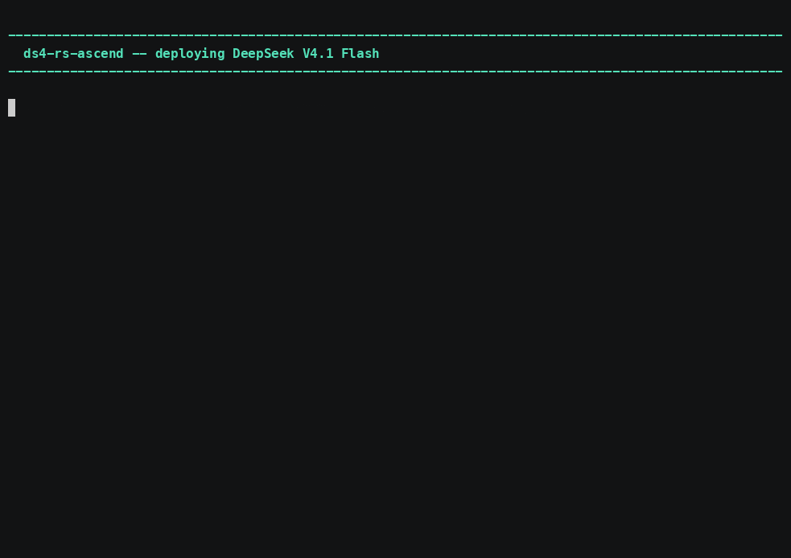

# ds4-rs-ascend — serve DeepSeek V4.1 Flash on Ascend

A serving utility: memory profile, parallel split, kernel-set registry.



*[Narrated MP4](../demo/media/ds4-rs-ascend.mp4) · 4:51 · [cue sheet](../demo/narration/ds4-rs-ascend.txt)*

## Build

```sh
cd ds4-rs-ascend && cargo build --release
```

A **separate Cargo workspace** from `rust/`, deliberately: those four tools have
no third-party dependencies at all and that is worth keeping checkable, while a
serving utility needs a SQLite registry, a signature verifier and a memory map.
Stable Rust, like the rest.

## Usage

```sh
ds4-rs-ascend mem                       # per-chip free HBM
ds4-rs-ascend plan   --mode latency     # the split it would choose, without serving
ds4-rs-ascend deploy --mode balanced    # plan, then serve
ds4-rs-ascend kernels list | verify     # the local kernel-set registry
ds4-rs-ascend profile --model ds4       # tune launch and tiling knobs on this box
ds4-rs-ascend help --advanced           # the expert knobs
```

`--mode` is the deployment **intent**, and the split follows from it rather than
being picked: `latency` for one user, `throughput` for aggregate tokens/sec,
`balanced` for a middle point, `max-context` for the longest context the box can
hold. TP, DP, EP and PP are not a free choice — two do nothing for a single
stream and two cost memory linearly, so the configuration follows from the
objective.

## What needs a card

**`mem` and `plan` need an Ascend driver on PATH.** The crate's own manifest
comment says the planning half works without the `ascend` cargo feature, and it
does — but the feature was never the only dependency: the memory profile shells
out to `npu-smi`, and `--mem-source` offers `npu-smi` or `acl` and nothing
synthetic. A capacity question still needs a box.

Works off a card: `version`, `help`, `help --advanced`, `kernels list`,
`kernels verify`.

## Two claims this tool does not make

- **The parallel split is a model.** Its own module header says nothing in it has
  run on multiple chips; the collective cost is an assumption, and so is the
  claim that *n* host links deliver *n* times one link's bandwidth. That is the
  first thing to measure.
- **`deploy` reports what it would run and refuses** rather than pretending to
  serve, until the engine lands under it. The refusal is information.

## Kernel sets are signature-verified

A kernel-set index is verified with Ed25519 before anything in it runs. The check
answers one question — *is this what was published* — and a test keeps it
present.

One debt this records rather than hides: dropping the FFI bridge to a vendored
third-party engine also removed a **correctness oracle**, and the Ascend side has
no equivalent yet. A CPU-reference comparison is owed.
